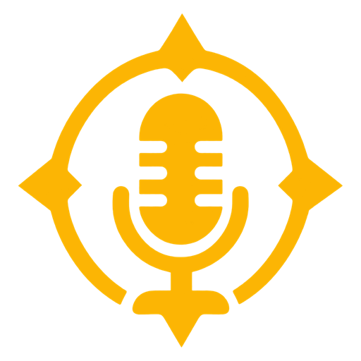

# AzerothVoice

**Proximity voice chat for World of Warcraft.** You hear other players depending on how close they are. In dungeons and raids you hear everyone in the instance.

🇩🇪 [Deutsche Anleitung](README.de.md)

> **Test phase.** Not approved by Blizzard, use at your own risk.
> AzerothVoice does **not** read game memory, does **not** interfere with the game and **never** presses keys. It only reads a few pixels from the WoW window, like a screen recording. The addon only uses official addon functions.

## Download

Download **`azeroth-voice.exe`** from **[Releases](../../releases/latest)**. There is nothing to install, just run it.

Windows may warn you on the first start ("Windows protected your PC") because the program is not signed yet. Click **"More info" → "Run anyway"**.

## Getting started

1. **Run `azeroth-voice.exe`.** The program checks for updates by itself and installs or updates the WoW addon automatically. If WoW is not found: **"Choose WoW folder …"**.
2. **Load the invitation:** you get the file `azeroth-voice-server.ini` from the host. Put it next to the exe or click **"Load invitation …"**.
3. **Mumble is set up automatically.** The program downloads the official Mumble installer, checks its signature and unpacks a **private copy** (no installation, no Windows prompt). **All game plugins are deleted** from this copy (including Mumble's own WoW plugin, which reads game memory), and so is the **overlay**. Only the AzerothVoice plugin is added. A normally installed Mumble is not used and must be closed while you play.
4. Nothing else to click: positional audio, push-to-talk and the server certificate are set up automatically, and Mumble updates are turned off.
5. **Log in to WoW.** As soon as a character is in the game, AzerothVoice connects automatically under that character's name. Switch characters and it reconnects with the new name; log out and it disconnects.
6. Play WoW in **"Windowed (Fullscreen)"** mode. The **Live** section of the program shows whether everything arrives.
7. **Bind the talk key** in WoW: Options → Keybindings → AddOns → AzerothVoice → "Talk (push-to-talk)". You only transmit while you hold it and WoW is in the foreground.

Mumble runs hidden in the system tray, you never need its window.

## In the game

- A **speech bubble** shows who is talking: on nameplates in the open world, on party and raid frames in dungeons and raids.
- The **"Talking now"** list shows everyone who is talking. `/av unlock` lets you move it, `/av lock` fixes it, `/av list` turns it on or off.
- **Mute** someone: right-click the player → **"AzerothVoice: Mute"** or `/av mute Name`. It takes effect immediately. `/av unmute Name` undoes it.
- **`/av`** shows the addon status.

## Microphone & sound

**In the game:** Options → AddOns → **AzerothVoice**, or `/av options`:

- **Microphone volume**, **overall volume** and **noise suppression** (RNNoise recommended).
- **Music protection:** anyone who transmits non-stop for longer than the set time (default 30 s) is turned down.
- **Test microphone:** records 3 seconds and plays them back to you.
- Also as commands: `/av mic 120`, `/av vol 80`, `/av music 30` or `/av music off`, `/av noise rnn`, `/av test`.

Only the **microphone and playback device** are chosen in the AzerothVoice window (default: the Windows default device). The window also shows a level meter.

## Safety

AzerothVoice uses its own cleaned Mumble copy with exactly one plugin, its own. A **guard** checks every 2 seconds that:
- no file of the copy was added or changed,
- Mumble has loaded no other plugin,
- the AzerothVoice plugin in Mumble answers (handshake).

If something is wrong, talking is blocked and Mumble is closed. The status is shown under **Live → Guard**.

## Troubleshooting

| Message | Fix |
|---|---|
| "No strip found" | Is the addon enabled in the WoW addon list? Tick "Load out of date AddOns" if needed, `/reload` |
| "WoW window not found" | Start WoW, mode "Windowed (Fullscreen)" |
| Voices come from the wrong side | In the program under "Advanced" → "Mirror left/right" |
| Everyone is always equally loud | Close Mumble and repeat "2. Set up Mumble" |
| "Another Mumble is running" | Close the regular Mumble (also in the system tray at the bottom right), then restart AzerothVoice |
| Guard: "plugin does not answer" | Use "Reconnect" in AzerothVoice |
| No level / microphone test silent | Is Mumble connected? Right microphone selected? |
